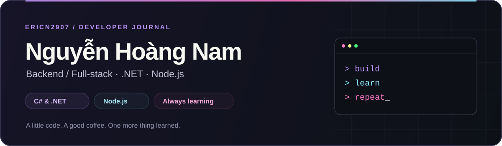

<h1 align="center">Hi, I'm Nam 👋🦆</h1>

  

  <a href="#projects">Projects</a> &nbsp; / &nbsp;
  <a href="#tech-stack">Tech stack</a> &nbsp; / &nbsp;
  <a href="#activity">Activity</a> &nbsp; / &nbsp;
  <a href="#connect">Say hello</a>

I'm **Nguyễn Hoàng Nam**, working toward becoming a backend / full-stack developer, with **.NET first**. I like useful APIs, clean project structure and learning by shipping small things.

Currently exploring **Clean Architecture**, **EF Core** and **cloud infrastructure**. Usually with a coffee nearby. ☕

---

## 🚀 Featured Projects

### [Serverless Student Management](https://github.com/EricN2907/fcj-fall2025-serverless-student-management-system)
A student management project combining a **Spring Boot backend**, **React frontend** and **AWS services**. A place to explore API design, authentication and cloud integration.

### [Glass Store Management](https://github.com/EricN2907/PRN222_glassStore)
A **C# / ASP.NET Core MVC** application with **SQL Server** and separate entity, repository and service layers. Built around the day-to-day needs of an eyewear store.

### [My Portfolio](https://github.com/EricN2907/my-portfolio)
My personal **Next.js** portfolio — a space to present my work and keep improving the way I tell the story behind it.

[Explore all repositories →](https://github.com/EricN2907?tab=repositories)

---

## 🛠️ Skills & Tech Stack

| Focus | Tools I work with |
| :--- | :--- |
| **Backend & APIs** | C# · .NET · Node.js · Java |
| **Data & cloud** | PostgreSQL · SQL Server · AWS |
| **Frontend foundations** | JavaScript · HTML · CSS |
| **Everyday tools** | Git · GitHub · Grafana · Obsidian |

  

### 🎯 My 2026 goals

- Grow into a professional **backend / full-stack developer**, starting with .NET.
- Go deeper into **Clean Architecture**, **EF Core** and cloud infrastructure.
- Build scalable products that help people solve real problems.
- Keep the habit: **500+ commits** on GitHub this year.

---

## 📊 My GitHub Activities

  
  

  

  

### 🏆 Trophy Cabinet

  <a href="https://github.com/ryo-ma/github-profile-trophy"><picture><source media="(max-width: 600px)" srcset="./assets/trophies-mobile.svg" /></picture></a>

Cards are saved in this repository and refreshed by Actions. <a href="./assets/card-status.json">Last successful refresh</a> · <a href="./assets/CREDITS.md">Sources &amp; licenses</a>

### 🐍 One contribution at a time

<picture>
  <source media="(prefers-color-scheme: dark)" srcset="https://raw.githubusercontent.com/EricN2907/EricN2907/output/github-contribution-grid-snake-dark.svg" />
  
</picture>

---

<b>☕ Off the keyboard — music, Discord &amp; a few fun facts</b>

I love coffee-shop coding sessions with lo-fi music. If a bug refuses to move, a short game break sometimes helps me come back with a clearer mind. 🎧

My favorite reminder: `while (!Success) { tryAgain(); if (Success) improve(); }`

### 🎮 My Discord

  

### 🎵 Currently Playing

  

---

## 🤝 Let's Connect

**Email:** [nemnguyenhoang2907@gmail.com](mailto:nemnguyenhoang2907@gmail.com) 
**Facebook:** [Nemsadboiz2907](https://www.facebook.com/Nemsadboiz2907) · **Discord:** [Say hello](https://discord.com/users/935763643721711626)

> Feel free to connect with me. Let's learn and grow together!
